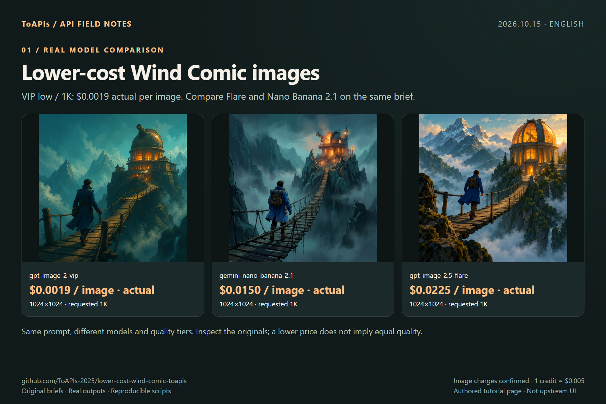

# Lower-cost Wind Comic ToAPIs images


<!-- TOAPIS-MODELS-20261020 -->
## Model support and prices · 2026-10-20

Added standalone API presets: 31 image request templates and 8 video presets. Current-key pricing matches 26 image and 8 video presets; 5 image templates block new paid calls while pricing is unavailable. Native provider/UI/import/render acceptance remains as documented in the original guide below.

| Image model / tested preset | Current preset quote / image | Historical example amount / image | Fee evidence |
|---|---:|---:|---|
| gpt-image-2(VIP)<br><sub>low</sub> | $0.0019/image | **$0.0019/image** | Billing log, phase unknown |
| gpt-image-2.5-flare-vip<br><sub>low</sub> | Current-key quote unavailable | **$0.005272/image**<br><sub>Token-metered; current $/M unavailable. This sample is not a fixed image tariff.</sub> | Task receipt settled |
| nano_banana<br><sub>1K</sub> | $0.012/image | **$0.012/image** | Billing log, phase unknown |
| gemini-nano-banana-2.1<br><sub>1K</sub> | $0.015/image | **$0.015/image** | Billing log, phase unknown |
| gpt-image-2<br><sub>1K</sub> | $0.015/image | **$0.015/image** | Billing log, phase unknown |
| gemini-nano-banana-2.1-vip<br><sub>1K</sub> | $0.02/image | **$0.02/image** | Billing log, phase unknown |
| qwen-image-3.0<br><sub>1K</sub> | Current-key quote unavailable | **$0.021/image** | Billing log, phase unknown |
| gpt-image-2.5-flare<br><sub>high</sub> | $0.0225/image | **$0.0225/image** | Billing log, phase unknown |
| gpt-image-2.5-sunburst<br><sub>high</sub> | $0.0225/image | **$0.0225/image** | Billing log, phase unknown |
| flux-2-pro<br><sub>1K</sub> | $0.025/image | **$0.025/image** | Billing log, phase unknown |
| doubao-seedream-5-0-pro<br><sub>1K</sub> | $0.042857/image | **$0.042856/image** | Billing log, phase unknown |

| Video model | Preset / input | Settled clip charge | File duration | Case USD/s, ascending |
|---|---|---:|---:|---|
| MiniMax-H3-Max-Turbo | 5s / 480P / text-to-video | $0.125/clip | 5.18s | **$0.024131/s**<br><sub>Pricing tariff: $0.025/s</sub> |
| seedance-2-mini | 4s / 480p / first-frame | $0.13338/clip | 4.04s | **$0.033015/s**<br><sub>Pricing tariff: $3.285714/M total tokens</sub> |
| seedance-2-fast | 4s / 480p / text-to-video | $0.214568/clip | 4.04s | **$0.053111/s**<br><sub>Pricing tariff: $5.285714/M total tokens</sub> |
| kling-v3 | 5s / 720p / std / text-to-video | $0.3/clip | 5.04s | **$0.059524/s**<br><sub>Pricing tariff: $0.06/s</sub> |
| MiniMax-H3 | 5s / 768p / text-to-video | $0.32/clip | 5.17s | **$0.061896/s**<br><sub>Pricing tariff: $0.064/s</sub> |
| seedance-2 | 4s / 480p / first-frame | $0.26676/clip | 4.04s | **$0.06603/s**<br><sub>Pricing tariff: $6.571429/M total tokens</sub> |
| kling-3.0-turbo | 4s / 720p / text-to-video | $0.32/clip | 4.04s | **$0.079208/s**<br><sub>Pricing tariff: $0.08/s</sub> |
| seedance-2-5 | 4s / 480p / text-to-video | $0.3883/clip | 4.04s | **$0.096114/s**<br><sub>Pricing tariff: $10/M total tokens</sub> |

Pricing checked 2026-10-20. Image examples are dated 2026-10-17; video examples 2026-10-20. Tables sort by example amount or case USD/s. Presets and input modes differ; this is not a matched-settings quality ranking. Unknown-phase image logs are not confirmed final net settlements. Current quotes and historical amounts are separate. Video charges are billing=settled; case USD/s divides charge by actual file duration, never processing time. Token tariffs appear in small text and do not imply a fixed per-second price.

gpt-image-2(VIP) starts at $0.0019/image; this low/1K preset is $0.0019/image. The standalone sampler has 31 historically successful image request templates and 8 video presets. Current-key pricing matches 26 image and 8 video presets; 5 image templates block new paid submission until an exact price is available.

[Local sampler](toapis-models/README.md) · [Full price table](PRICING.md) · [Original media and fee evidence](https://github.com/ToAPIs-2025/toapis-quickstart/tree/main/tutorials/model-support-2026-10-20)

Original project examples, historical charges and integration instructions follow. Historical amounts are not rewritten as today’s quotes.

<!-- /TOAPIS-MODELS-20261020 -->

<!-- TOAPIS-MODEL-COST-UPDATE-20261016 -->
## Tested model types, presets and costs

Updated October 16, 2026. These are tested historical presets/prices; this addition does not relabel the original batch below.

| Model (API ID) | Type | Tested preset | Unit quote | Confirmed unit charge | Count |
|---|---|---|---:|---:|---:|
| gpt-image-2(VIP) (`gpt-image-2-vip`) | Image | low / 1K / n=1 | $0.0019/image | $0.0019 | 1 |
| gpt-image-2.5-flare | Image | high / 1K / n=1 | $0.0225/image | $0.0225 | 1 |
| Nano Banana 2.1 (`gemini-nano-banana-2.1`) | Image | 1K / n=1 | $0.015/image | $0.015 | 1 |

Confirmed original image/video example subtotal: **$0.0394**.

Original image-provider registry validated; the video addition uses the original video registry and optional ToAPIs provider. Full film pipeline remains unvalidated.

gpt-image-2(VIP), **from $0.0019/image**; the tested low/1K preset here is **$0.0019/image**. Different models, qualities and resolutions do not imply equivalent results.

[Video additions, parameters, costs and reuse](video_extra/README.md)
<!-- TOAPIS-VIDEO-PREVIEWS-20261016 -->
### Seedance video demos and clip costs

[](https://raw.githubusercontent.com/ToAPIs-2025/lower-cost-wind-comic-toapis/community/toapis-low-cost/video_extra/clips/seedance-2-mini.mp4)

**Seedance 2 Mini** · 480p · 4.04s · **$0.127484/clip** · about $0.031555/s

API settlement matches the owner-confirmed charges. USD/s is specific to these clips.

<!-- /TOAPIS-VIDEO-PREVIEWS-20261016 -->
<!-- /TOAPIS-MODEL-COST-UPDATE-20261016 -->


[中文](README_zh-CN.md) · [Original README](README.upstream.md)


[ToAPIs · model pricing & API](https://go2v.toapis.com/wi15ge)


**2026-10-15: 3 real outputs; actual image charges $0.0394 (7.88 credits), confirmed from the backend screenshot.**


The original image-provider registry selects the optional ToAPIs provider and generates real images. Video submission returned HTTP 503; no video output or full-app validation.


## Demo





## Prices for the tested models


| Model | Requested preset | Actual pixels | Quote / request | Actual charge |

|---|---|---|---:|---|

| [`gpt-image-2-vip`](https://go2v.toapis.com/wi15v) | low / 1K | 1024×1024 | $0.0019 | $0.0019 / 0.38 credits |

| [`gemini-nano-banana-2.1`](https://x.toapis.com/wi15n) | 1K | 1024×1024 | $0.0150 | $0.0150 / 3 credits |

| [`gpt-image-2.5-flare`](https://im25.toapis.com/wi15f) | high / 1K | 1024×1024 | $0.0225 | $0.0225 / 4.5 credits |


Actual image total: **$0.0394**. Image charges were confirmed from the backend screenshot; 1 credit = $0.005. Global uses owner-provided pricing; other quotes use the live `/v1/pricing` catalog. Different models and quality tiers do not imply equal quality.


## Reproduce


Python 3.11+; Node 22+ for Node/TS native-entry checks.


```bash

python -m pip install Pillow

python generate_case.py --model gpt-image-2-vip --prompt "An original product photograph, no text"

# Dry-run: no network call. Set TOAPIS_API_KEY privately before --live.

python generate_case.py --model gpt-image-2-vip --prompt "An original product photograph, no text" --run-id my-unique-case --output result.png --live

```


`TOAPIS_BASE_URL=https://toapis.com` or `https://toapis.cn`; `/v1` is appended once. `TOAPIS_STATE_DIR` stores private durable task state. `TOAPIS_MAX_IMAGE_USD` defaults to 0.10. Never commit the key or private state.


### Native entry and scope


`lib/image-providers/toapis.ts` registers `toapis-image`; `smoke_native.ts` selects it through the original registry. Build with `npx esbuild smoke_native.ts --bundle --platform=node --format=esm --external:../../toapis_tools/toapis_bridge.mjs --outfile=smoke_native.mjs`, then fix the external bridge path to `./toapis_tools/toapis_bridge.mjs` or use the supplied compiled file. Set `NODE_ENV=test`, `TOAPIS_PYTHON`, `TOAPIS_IMAGE_MODEL`, and a unique `TOAPIS_RUN_ID`.


`node smoke_native.mjs < case.json`. Native image response contains an HTTPS output URL and upstream task ID. References and non-square presets are intentionally disabled.


**Video not accepted:** `lib/video-providers/toapis.ts` and `smoke_video.ts` are supplied as integration work in progress. Grok 1.5 / 4s / 480p quoted $0.0408, submission returned HTTP 503 without an ID. No output, no settled charge confirmed, no automatic retry. ToAPIs errors stop the registry rather than triggering another paid provider.


### API mapping


`POST /v1/images/generations` → persist returned task ID → `GET /v1/images/generations/{id}` → download result without forwarding the API key to the CDN. Bearer authentication is used only for the API origin. No automatic POST retries. Uncertain submissions remain blocked until reconciled.


The adapter maps explicit pixel hints to aspect ratio and sends model-specific resolution fields. JPEG responses are preserved as original JPEG and separately converted to PNG for display; real pixel sizes are recorded. A requested 1K tier is not a guarantee of exactly 1024×1024 pixels.


## Evidence and screenshot walkthrough


- [Per-task records](evidence/)

- [Original outputs](examples/)

- [Model comparison](screenshots/en/01-models.png)

- [API steps](screenshots/en/02-api.png)

- [Reuse and limits](screenshots/en/03-reuse.png)


Upstream: [ChrisChen667788/wind-comic](https://github.com/ChrisChen667788/wind-comic/tree/7e39f530cfc809e23990b8fcf5e0855e9177ebe6), pinned `7e39f530cfc809e23990b8fcf5e0855e9177ebe6`. Community work; no author endorsement or existing partnership is implied. [Attribution](NOTICE.md).


[Dashboard-confirmed itemized image charges](evidence/actual-charges.json). Video submissions without task IDs are excluded and remain unreconciled.


## Upstream sponsor entry preserved

<a href='https://metaso.cn/minimax-h3/?s=wind-comic'></a>

Preserved from the original project; no exclusivity or ToAPIs partnership is inferred.

Experimental video registration is disabled by default. It requires an explicit server setting TOAPIS_ENABLE_VIDEO=1 after reconciling the failed submission and confirming a working API contract.
