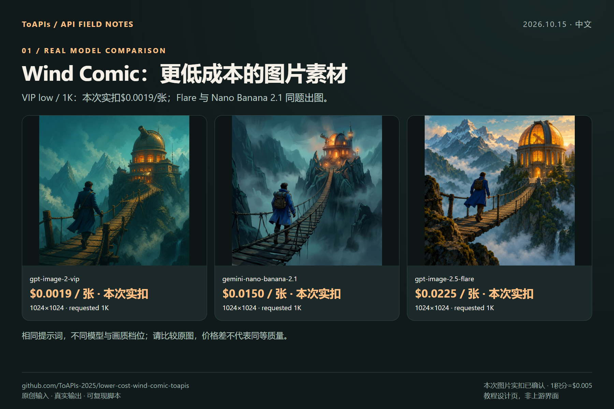

# 更低成本的 Wind Comic 图片与视频方案

<!-- TOAPIS-PROJECT-LINKS-20261022 -->
[ToAPIs 官网首页](https://home.toapis.com/WindComic) · [模型价格](https://pricing.toapis.com/WindComic)
<!-- /TOAPIS-PROJECT-LINKS-20261022 -->


<!-- TOAPIS-MODELS-20261020 -->
## 模型与价格更新 · 2026-10-20

新增可独立运行的31套图片请求模板、8套视频模板。当前26套图片与8套视频可匹配同Key精确价格；另5套图片缺价，默认阻止新付费调用。它们属于额外API脚本；项目原生Provider、UI、导入及完整出片的验收范围仍以下方原教程为准。

| 图片模型／实测档位 | 当前档位报价／张 | 历史案例金额／张 | 费用证据 |
|---|---:|---:|---|
| gpt-image-2(VIP)<br><sub>low</sub> | $0.0019/image | **$0.0019/image** | 计费日志，阶段未知 |
| gpt-image-2.5-flare-vip<br><sub>low</sub> | 当前Key暂未返回报价 | **$0.005272/image**<br><sub>Token计费；当前$/M未返回，本例金额不是固定单张价。</sub> | 任务回执已结算 |
| nano_banana<br><sub>1K</sub> | $0.012/image | **$0.012/image** | 计费日志，阶段未知 |
| gemini-nano-banana-2.1<br><sub>1K</sub> | $0.015/image | **$0.015/image** | 计费日志，阶段未知 |
| gpt-image-2<br><sub>1K</sub> | $0.015/image | **$0.015/image** | 计费日志，阶段未知 |
| gemini-nano-banana-2.1-vip<br><sub>1K</sub> | $0.02/image | **$0.02/image** | 计费日志，阶段未知 |
| qwen-image-3.0<br><sub>1K</sub> | 当前Key暂未返回报价 | **$0.021/image** | 计费日志，阶段未知 |
| gpt-image-2.5-flare<br><sub>high</sub> | $0.0225/image | **$0.0225/image** | 计费日志，阶段未知 |
| gpt-image-2.5-sunburst<br><sub>high</sub> | $0.0225/image | **$0.0225/image** | 计费日志，阶段未知 |
| flux-2-pro<br><sub>1K</sub> | $0.025/image | **$0.025/image** | 计费日志，阶段未知 |
| doubao-seedream-5-0-pro<br><sub>1K</sub> | $0.042857/image | **$0.042856/image** | 计费日志，阶段未知 |

| 视频模型 | 档位／输入 | 本例消费 | 文件时长 | 本例每秒金额（升序） |
|---|---|---:|---:|---|
| MiniMax-H3-Max-Turbo | 5s / 480P / 文生视频 | $0.125/clip | 5.18s | **$0.024131/s**<br><sub>pricing底层费率：$0.025/s</sub> |
| seedance-2-mini | 4s / 480p / 首帧 | $0.13338/clip | 4.04s | **$0.033015/s**<br><sub>pricing底层费率：$3.285714/M total tokens</sub> |
| seedance-2-fast | 4s / 480p / 文生视频 | $0.214568/clip | 4.04s | **$0.053111/s**<br><sub>pricing底层费率：$5.285714/M total tokens</sub> |
| kling-v3 | 5s / 720p / std / 文生视频 | $0.3/clip | 5.04s | **$0.059524/s**<br><sub>pricing底层费率：$0.06/s</sub> |
| MiniMax-H3 | 5s / 768p / 文生视频 | $0.32/clip | 5.17s | **$0.061896/s**<br><sub>pricing底层费率：$0.064/s</sub> |
| seedance-2 | 4s / 480p / 首帧 | $0.26676/clip | 4.04s | **$0.06603/s**<br><sub>pricing底层费率：$6.571429/M total tokens</sub> |
| kling-3.0-turbo | 4s / 720p / 文生视频 | $0.32/clip | 4.04s | **$0.079208/s**<br><sub>pricing底层费率：$0.08/s</sub> |
| seedance-2-5 | 4s / 480p / 文生视频 | $0.3883/clip | 4.04s | **$0.096114/s**<br><sub>pricing底层费率：$10/M total tokens</sub> |

报价核对：2026-10-20。图片案例日期2026-10-17；视频案例日期2026-10-20。表格按本例金额／秒金额排序，质量、分辨率和输入不同，不是同配置质量排名。图片日志的阶段未知，不能当作单任务最终净结算；当前报价与历史金额分别显示。视频金额均由billing=settled确认，$/s按实际文件时长折算，任务处理耗时不参与计算。Token模型不是固定每秒价，底层$/M只作小字补充。

gpt-image-2(VIP)通用价格为$0.0019/image起；本例low/1K为$0.0019/image。新脚本有31套历史成功图片请求模板、8套视频模板；当前26套图片与8套视频可匹配价格，另5套图片因当前Key缺价而默认阻止新付费调用。

[本仓库多模型脚本](toapis-models/README_zh-CN.md) · [完整价表](PRICING_zh-CN.md) · [原图／视频及费用证据](https://github.com/ToAPIs-2025/toapis-quickstart/tree/main/tutorials/model-support-2026-10-20)

下方保留原项目历史案例、消费及集成说明；历史金额不改成今天的新报价。

<!-- /TOAPIS-MODELS-20261020 -->

<!-- TOAPIS-MODEL-COST-UPDATE-20261016 -->
## 模型类型、测试档位与花费

更新：2026-10-16。下表为已验证案例的历史档位与价格；本段补充不改变下方原批次记录。

| 模型（API ID） | 类型 | 测试档位 | 单次报价 | 已确认单次消费 | 数量 |
|---|---|---|---:|---:|---:|
| gpt-image-2(VIP) (`gpt-image-2-vip`) | 图片 | low / 1K / n=1 | $0.0019/image | $0.0019 | 1 |
| gpt-image-2.5-flare | 图片 | high / 1K / n=1 | $0.0225/image | $0.0225 | 1 |
| Nano Banana 2.1 (`gemini-nano-banana-2.1`) | 图片 | 1K / n=1 | $0.015/image | $0.015 | 1 |

原图片/视频案例已核对消费小计：**$0.0394**。

原图片Provider注册表已验证；新增视频补测走原视频注册表及可选ToAPIs Provider，完整成片未验收。

gpt-image-2(VIP) **$0.0019/image 起**；本表 low/1K 实测档位为 **$0.0019/image**。不同模型、质量和分辨率不代表同质效果。

[视频补测、参数、费用与复用](video_extra/README_zh-CN.md)
<!-- TOAPIS-VIDEO-PREVIEWS-20261016 -->
### Seedance 视频演示与本条消费

[](https://raw.githubusercontent.com/ToAPIs-2025/lower-cost-wind-comic-toapis/community/toapis-low-cost/video_extra/clips/seedance-2-mini.mp4)

**Seedance 2 Mini** · 480p · 4.04s · **$0.127484/clip** · 约 $0.031555/s

API结算与后台表单一致。美元/秒为本条配置折算。

<!-- /TOAPIS-VIDEO-PREVIEWS-20261016 -->
<!-- /TOAPIS-MODEL-COST-UPDATE-20261016 -->


[English](README.md) · [上游说明](README.upstream.md)


[ToAPIs · 对应模型价格与接入](https://pricing.toapis.com/WindComic)


**2026-10-15：3 张真实输出，图片实扣合计 $0.0394（7.88积分），后台截图已确认。**


原 ImageProvider/VideoProvider注册表 → 新ToAPIs Provider；全剧本到成片与Next.js页面未验收。


## 演示





## 本次对应模型价格


| Model | Requested preset | Actual pixels | Quote / request | Actual charge |

|---|---|---|---:|---|

| [`gpt-image-2-vip`](https://pricing.toapis.com/WindComic) | low / 1K | 1024×1024 | $0.0019 | $0.0019 / 0.38 credits |

| [`gemini-nano-banana-2.1`](https://pricing.toapis.com/WindComic) | 1K | 1024×1024 | $0.0150 | $0.0150 / 3 credits |

| [`gpt-image-2.5-flare`](https://pricing.toapis.com/WindComic) | high / 1K | 1024×1024 | $0.0225 | $0.0225 / 4.5 credits |


本次图片实扣合计： **$0.0394**. 本次图片实扣已由后台截图确认；1积分=$0.005。除 global 为用户提供价表，其余为当天实时 `/v1/pricing`。不同模型/画质不是等效质量比较。


## 复现


环境：Python 3.11及以上；Node/TS原生入口验收另需Node 22及以上。


```bash

python -m pip install Pillow

python generate_case.py --model gpt-image-2-vip --prompt "An original product photograph, no text"

# 默认演练不联网。实测前在本机私下配置 TOAPIS_API_KEY，再显式加 --live。

python generate_case.py --model gpt-image-2-vip --prompt "An original product photograph, no text" --run-id my-unique-case --output result.png --live

```


`TOAPIS_BASE_URL`可填`https://toapis.com`或`https://toapis.cn`，只补一次`/v1`。`TOAPIS_STATE_DIR`保存本地私有任务状态；`TOAPIS_MAX_IMAGE_USD`默认单图报价上限为0.10。不要提交Key或私有状态目录。


### 原生入口与范围


`lib/image-providers/toapis.ts`注册`toapis-image`；`smoke_native.ts`通过原注册表选择该Provider。 Build with `npx esbuild smoke_native.ts --bundle --platform=node --format=esm --external:../../toapis_tools/toapis_bridge.mjs --outfile=smoke_native.mjs`, then fix the external bridge path to `./toapis_tools/toapis_bridge.mjs` or use the supplied compiled file. Set `NODE_ENV=test`, `TOAPIS_PYTHON`, `TOAPIS_IMAGE_MODEL`, and a unique `TOAPIS_RUN_ID`.


`node smoke_native.mjs < case.json`. 原生图片响应包含HTTPS结果URL与上游任务ID。参考图和非方图预设尚未开放。


**视频未验收通过：** `lib/video-providers/toapis.ts` and `smoke_video.ts` 是待完成验收的接入代码。 Grok 1.5 / 4s / 480p quoted $0.0408, 提交返回HTTP503且没有任务ID，无视频输出、实扣未知，没有自动重试。ToAPIs报错会中止当前注册表派发，不自动转向另一付费Provider。


### 接口映射


`POST /v1/images/generations`提交一次并保存返回任务ID，再通过`GET /v1/images/generations/{id}`查询结果。下载CDN图片时不转发API Key；Bearer仅发给允许的API域名。没有自动POST重试，未确认是否受理的提交会保留并阻止重复生成。


适配器将像素提示转换为画幅比例，并按模型发送分辨率字段。JPEG结果保留原始字节，另存PNG供展示；真实尺寸均写入记录。请求1K不保证返回恰好1024×1024。


## 证据与截图教程


- [逐任务记录](evidence/)

- [原始输出](examples/)

- [模型对比](screenshots/cn/01-models.png)

- [API调用步骤](screenshots/cn/02-api.png)

- [复用与验收边界](screenshots/cn/03-reuse.png)


Upstream: [ChrisChen667788/wind-comic](https://github.com/ChrisChen667788/wind-comic/tree/7e39f530cfc809e23990b8fcf5e0855e9177ebe6), pinned `7e39f530cfc809e23990b8fcf5e0855e9177ebe6`. 社区独立示例，不代表作者背书或已有合作。[署名与许可](NOTICE.md)。


[后台确认的逐项图片消费](evidence/actual-charges.json)。未取得任务ID的视频提交不计入图片合计，仍单独待核。


## Upstream sponsor entry preserved

<a href='https://metaso.cn/minimax-h3/?s=wind-comic'></a>

Preserved from the original project; no exclusivity or ToAPIs partnership is inferred.

Experimental video registration is disabled by default. It requires an explicit server setting TOAPIS_ENABLE_VIDEO=1 after reconciling the failed submission and confirming a working API contract.
